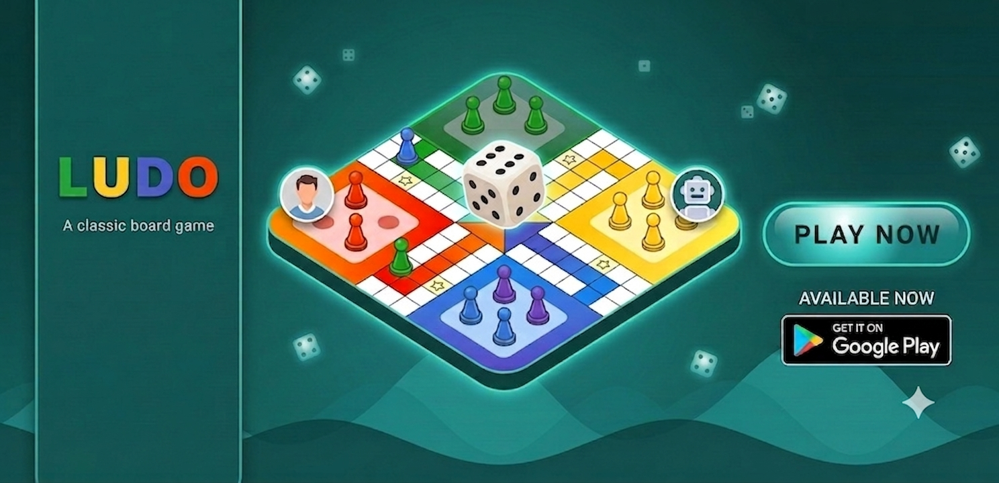
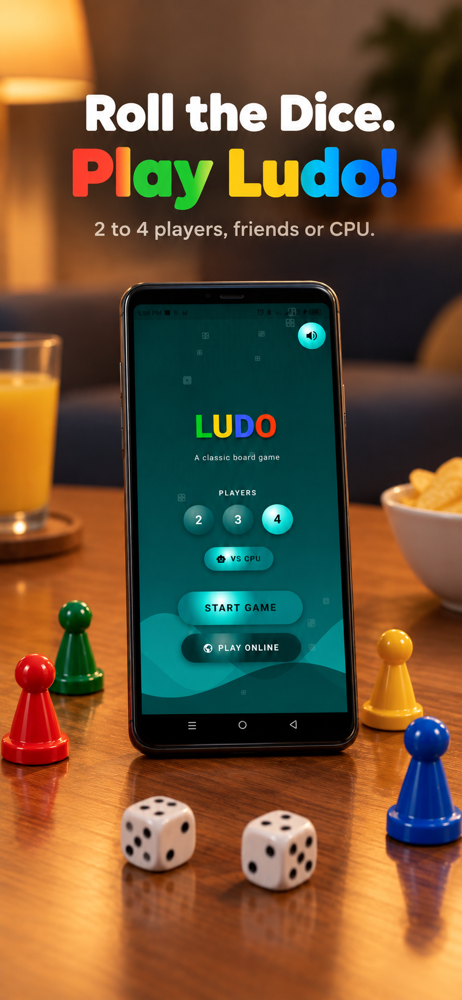
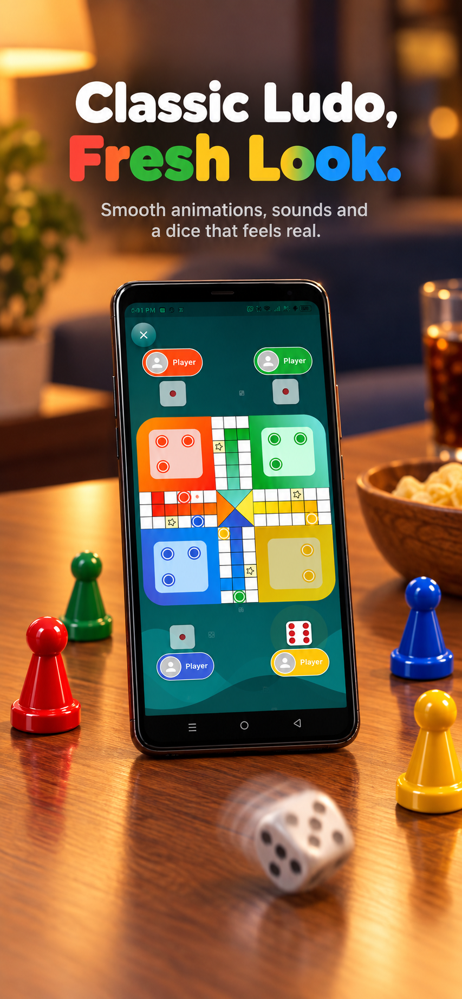

# MyLudo



The classic Ludo board game, made for playing with friends online: host a room, share a code or QR, and play together in real time. Built with Flutter and Firebase.

**[Play in the browser →](https://myludo-tunisie.web.app)**

<p align="center">
  
  
  
</p>

## Features

- **Local play**: 2 to 4 players on one device, with CPU opponents.
- **Online multiplayer**: host a room for 2 to 4 players and invite friends with a room code, a QR code or the share sheet; join by typing the code or scanning it.
- **Live lobby**: see who has joined; the host starts the match for everyone.
- **Real-time game sync** through Firebase Realtime Database; if a player leaves, the match ends cleanly for everyone.
- **Player profiles**: name and optional photo, remembered between sessions.
- Board rotated to each player's own colour, animated dice-rain background, sounds.

## How online play works

| Piece | Role |
|---|---|
| Firebase Authentication | Anonymous sign-in, so each player gets an ID to join rooms (no account needed) |
| Firebase Realtime Database | `rooms/{code}`: players, colours, lobby state and the game state (dice, moves) |
| `lib/services/room_service.dart` | Create / join rooms, live lobby, in-game sync |
| `lib/services/profile_service.dart` | Stores name and photo locally |
| `database.rules.json` | Only signed-in users can read/write rooms; validates names, photos and dice values |

## Run it

```bash
flutter pub get
flutterfire configure   # creates the Firebase config files (not committed)
flutter run
```

The Firebase client config (`lib/firebase_options.dart`, `android/app/google-services.json`, `ios/Runner/GoogleService-Info.plist`) is kept out of this repository. Create your own Firebase project with **Authentication** and **Realtime Database** enabled, run `flutterfire configure`, then deploy the rules:

```bash
firebase deploy --only database
```

Web build: `flutter build web && firebase deploy --only hosting`.

## Credits

MyLudo is built on **[NLudo Flutter](https://github.com/nizwar/ludo_flutter)** by **Mochamad Nizwar Syafuan** (© 2022), the original single-device Ludo game, licensed under Apache 2.0. Thank you for the great base.

Changes in this fork by Mohamed Ben Hmida (2026):
- Online multiplayer with Firebase: rooms, lobby, QR / code invites, real-time sync
- Player profiles with name and photo
- Redesigned player chips, board centering and dice-rain background
- Renamed to MyLudo (`tn.medbh.myLudo`)
- Migrated the Android build to the current Gradle / AGP / Kotlin DSL

## License

Apache License 2.0, see [LICENSE](LICENSE). Original work © 2022 Mochamad Nizwar Syafuan; modifications © 2026 Mohamed Ben Hmida.
